<!-- cards:start -->
<!-- Gerado por scripts/render_cards.py — edite o profile.json em vez deste bloco. -->



<a href="https://github.com/DiegoMaiochi"></a>
<a href="https://github.com/DiegoMaiochi?tab=repositories"></a>
<a href="https://github.com/DiegoMaiochi"></a>



<a href="https://github.com/DiegoMaiochi/AgentStudio"></a>
<a href="https://github.com/DiegoMaiochi/Sistema-de-Assinatura"></a>
<a href="https://github.com/DiegoMaiochi/SerafinConnect"></a>
<a href="https://github.com/DiegoMaiochi/Landing-Page-Pizzaria"></a>

<!-- cards:end -->

### ✨ Um pouco sobre mim

- ☕ Amo café
- 🎮 Curto jogos, séries e filmes
- 💡 Gosto de aprender coisas novas e construir projetos úteis

Os cartões acima são SVGs animados gerados por <code>scripts/render_cards.py</code> com meus dados reais do GitHub e atualizados todo dia por um GitHub Action. Para mudar textos, cores ou repositórios em destaque, edite o <code>profile.json</code>.
